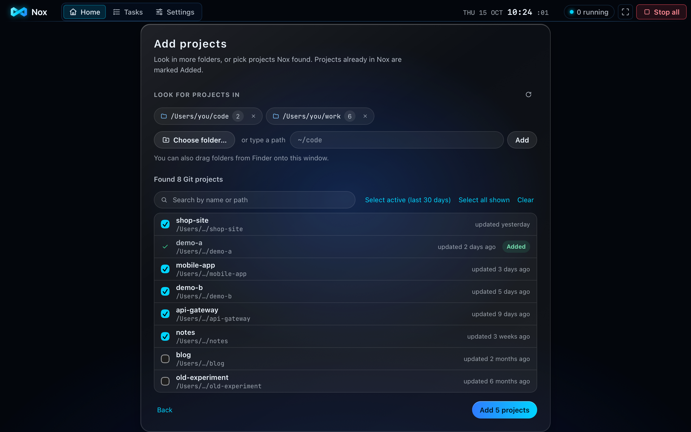
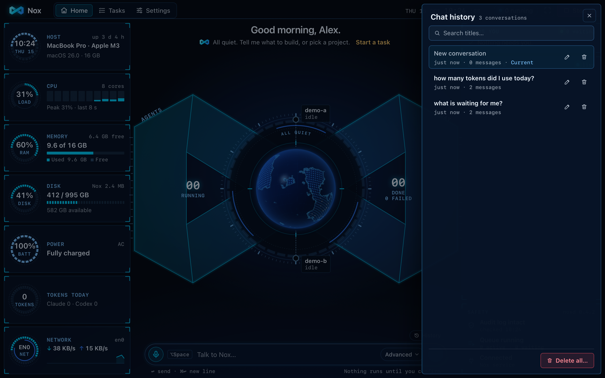
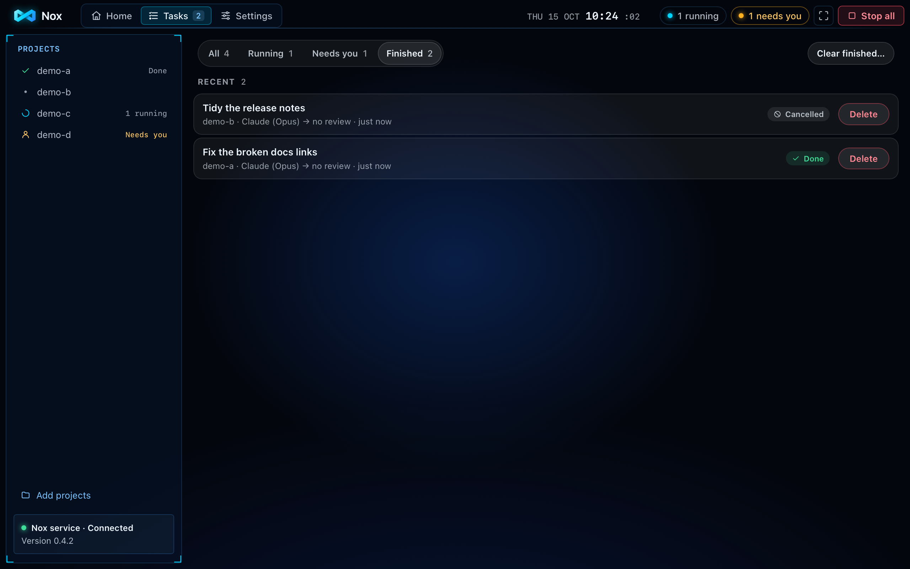
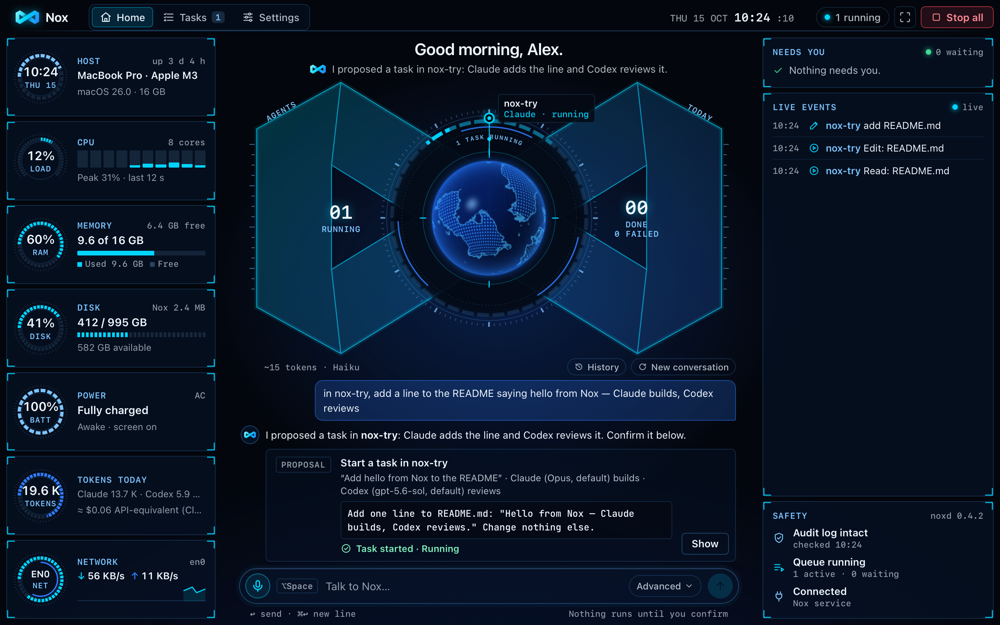

# Nox

**A command centre for your AI coding agents, on your Mac.** Nox runs Claude Code and Codex on your git projects: you
say what you want, one agent builds, the other reviews, and you decide what to keep.

- **Automations (new in 0.7.0).** A new page (`⌘5`): after a session changes your code, the other agent reviews it read-only and the findings come back in the chat with **Fix these**; plus scheduled **Update all** and **Morning review**, with reports and alerts. Sounds are now quiet by default, and typing Chinese or Japanese no longer sends on Enter.
- **Update all, and talk to your sessions (new in 0.6.1).** One **Update all** in Tools updates every tool, Claude plugin and Codex marketplace, one step at a time, with live progress and **Cancel the rest**. In Sessions, tap the mic to speak a message and hear the reply read aloud (never code, paths or keys).
- **Sessions, like Terminal (new in 0.6.0).** Chat with Claude Code or Codex straight in any project's real folder, with your own plugins, MCP servers and `CLAUDE.md`. Pick the model and the access: ask first, auto-edit, or **Full access** (nothing asks; Nox confirms it with you once, and `⌥⌘.` still stops everything).
- **Tools in one place (new in 0.6.0).** See and update Node, Claude Code and Codex with one click (Nox uses the installer that put each there), manage Claude and Codex plugins, marketplaces and MCP servers (secrets are never shown), and set default models, Fable included.
- **All your projects at once (new in 0.6.0).** **Add all found** adds every repo in your code folders in one go, and watched folders can add new repos by themselves (one you removed never comes back).
- **Live alerts with sound, and a System theme (new in 0.6.0).** Everything that needs you appears at once with a soft cue. Switch to the **System** look for holographic alert windows, levels, ranks and three daily quests earned from real work.
- **Talk, then confirm.** Type or say "in shop, fix the failing date test". Nox shows exactly what will run on a card; nothing starts until you press **Confirm**.
- **Nox Notch.** A pill around the MacBook notch (top-centre pill on other Macs) shows what agents are doing in words: blue running, orange needs you, red failed. Hover for Allow, Deny, Always allow here and Stop; buttons wake up a moment after it opens so a stray click never approves.
- **A task board.** Needs you · Running · Done, with an unseen-activity dot. Type the next instruction while an agent works and it's sent when the run ends; **Run again** repeats a finished task.
- **English or Chinese.** Talk or write to Nox in English or Mandarin (mixed is fine, like "帮我 run 一下 test"); it understands both and answers in the same language.
- **One natural voice, built in.** Nox speaks in one natural female voice, in English and in Chinese, made on your Mac. It downloads once by itself (about 0.7 GB) and then works offline; until it is ready Nox uses a Mac voice.
- **A slim Notch.** Nox lives in your MacBook's notch: pure black, a tiny dot and a number, folding away when nothing is happening; hover for Allow / Deny / Stop.
- **Tour, What's new and Help.** A six-step tour on first run, a what's-new card after each update, and the full guide inside Nox (the **?** button), offline.
- **Hardened runtime.** Nox is signed with macOS's hardened runtime and asks only for the microphone.
- **Chat history.** Nox keeps your conversations with it on your Mac. **History** lists them with a search; open one to carry on, rename it, or delete one or all.
- **Adding projects that feels natural.** **Choose folder…**, drag a folder from Finder, or type `~/code`. Nox looks as soon as a folder is added, lists projects by when they were last used, and lets you search, **Select active** and add in one go. **Remove from Nox** forgets a project without touching your folder.
- **Tidy tasks, one Stop.** A Tasks filter (All, Running, Needs you, Finished), **Delete** and **Clear finished…** for old tasks (your branches and repos are never touched), and one **Stop all** that says **All agents stopped** until you resume.
- **Storage you control.** **Settings → Storage** says what Nox keeps on your Mac and frees space safely: **Clear cache**, **Free task copies** (also automatic, 7 days after a task finishes by default), **Reset voice** and **Remove voice models**. Your projects, branches, chat history and audit log are never touched.
- **Honest updates.** The update pill shows megabytes, speed and time left, and says **Waiting for the network…** when nothing arrives.
- **Two agents, one team.** One builds, the other reviews, each task in its own copy of your repo. Nothing in your repo changes while they work.
- **Your branch, your models.** A task starts from the branch you are on, or one you name ("on feature/login"). Claude tasks run Opus and Codex tasks the model your Codex config names, unless you pick others in Settings or for one task.
- **A Review Desk.** The diff with every review finding pinned under its line: **Keep work → main** (onto the branch the task started from, when that is safe), **Send back** or **Discard**.
- **Talk to the fleet.** "Approve the low-risk ones" puts several waiting low- or medium-risk agent requests on one card; high-risk requests are decided one at a time, and **Keep work** / **Discard** is always decided on its own card.
- **Safe by default.** Agents are sandboxed, risky commands wait for **Allow**, `⌥⌘.` stops everything, and every task's tokens are counted against a budget.
- **From your iPhone or iPad.** Reach the Mac itself with RustDesk over Tailscale and use the whole Nox window (Nox's own phone site was removed in 0.5.5).


<sub>All screenshots are Nox's real Mac interface, taken by an automated test with demo projects, simulated agents shown
as Claude and Codex, and a fixed clock. No real work or person is shown.</sub>

## Screenshots

| | |
|---|---|
|  |  |
| **Talk, then confirm.** The card shows the agent's whole instructions before anything runs. | **Review Desk.** Changed files, the diff, every finding under its line, and Send back. |
|  |  |
| **Several decisions, one card.** Each result shown; the high-risk push still waits for you. | **Tokens and budget.** Tokens today, and a card when a task passes its budget while its agent works. Nothing stops by itself. |
|  |  |
| **First run.** Your folders are searched as soon as they are added; pick your Git projects. | **Keep work.** The card says where the work goes: **Keep work → main**, the branch the task started from. |
|  |  |
| **Add projects.** Choose a folder or drop one from Finder; results by last use, marked **Added** when already in Nox. | **Chat history.** Your conversations stay on your Mac until you delete them. |
|  |  |
| **Tasks filter.** Show only what is finished, then **Delete** one or **Clear finished…**. | **At work.** The task you confirmed runs; live events, tokens today and what needs you stay in view. |

## Install

**You need:** a Mac with Apple Silicon (M1 or newer) on macOS 13 or newer; Claude Code and/or Codex CLI, installed and
logged in with your own account (talking to Nox uses Claude Code); git 2.40 or newer at `/usr/bin/git` (Xcode Command
Line Tools).

1. Download `Nox_<version>_aarch64.dmg` from [Releases](https://github.com/jimmy-nvx/nox-releases/releases/latest).
2. Open the DMG and drag **Nox** into **Applications**.
3. Open Nox the first time. It is not notarized by Apple yet, so macOS blocks a plain double-click once:
   - **macOS 15 and newer:** double-click **Nox** and click **Done**. Open **System Settings → Privacy & Security**,
     scroll to **Security**, click **Open Anyway** next to the message about Nox, and confirm with your password or
     Touch ID.
   - **macOS 13 and 14:** right-click **Nox** in Applications, choose **Open**, then click **Open**.
   - If macOS says Nox is "damaged": run `xattr -dr com.apple.quarantine /Applications/Nox.app` once and try again.

On first launch Nox starts its background service, adds two items to your login Keychain (`pro.nvx.nox.api`,
`pro.nvx.nox.audit`) and shows **Welcome to Nox**, where you pick your projects. Later versions install from inside Nox
(**Update available → Update**).

## How to use it

1. **Pick projects** on the Welcome screen (more later: **Tasks → Add projects**).
2. **Ask** in the bar at the bottom, for example `in nox-try, add a line to the README saying hello from Nox — Claude
   builds, Codex reviews`, and press **Enter**. Or press `⌥Space` and speak.
3. **Confirm** the proposal card. Watch the task on the ring and in **Live events**.
4. **Answer** what waits under **Needs you**: **Allow** or **Deny** a risky command; for finished work, **Open Review
   Desk**, then **Keep work**, **Send back** or **Discard**.
5. **Keep work → main** moves the branch the task started from forward to the work, so your checkout's files include the
   change. Nox does that only when it is safe: nobody committed to that branch since the task started, and its checkout
   has no uncommitted changes. Otherwise the card says why before you decide, and the work is saved on a `nox/…` branch
   for you to merge when you want. Nox never makes a merge commit, never force-moves a branch and never pushes.

`⌥⌘.` stops every agent at once. `⌘1` Home · `⌘2` Tasks · `⌘3` Sessions · `⌘4` Tools · `⌘,` Settings · `⌘K` everything else. The full illustrated guide is
[Nox User Guide (PDF)](Nox-User-Guide.pdf).

## Evidence

Every number below comes from a recorded run, with its date. Nothing is estimated unless it says so.

### Tests — 2026-10-24, v0.6.1 (latest recorded run)

| Suite | Result |
|---|---|
| Service, scripts and voice-helper tests (bun) | 1,705 pass, 0 fail |
| UI unit and component tests (desktop vitest) | 1,930 pass (1 skipped) |
| Rust shell tests (cargo) | 119 pass |
| End-to-end (Playwright on WebKit, against a real Nox service per test) | 67 passed, 0 failed, 9 skipped |
| The built, signed app (hardened-runtime smoke test) | pass |
| The built app on this Mac (smoke-app) | memory: 217 MB · Nox service: 60 MB, 0.34 % CPU idle · hidden: 0.23 % CPU · cold start: 309 ms · recovers from a killed service in 1.0 s. Idle CPU with the window in front stays over its 3 % budget on this Mac, as 0.5.6 and 0.6.0 do |

### Tests — 2026-10-24, v0.6.0 (older)

| Suite | Result |
|---|---|
| Service, scripts and voice-helper tests (bun) | 1,673 pass, 0 fail |
| UI unit and component tests (desktop vitest) | 1,842 pass (1 skipped) |
| Rust shell tests (cargo) | 119 pass |
| End-to-end (Playwright on WebKit, against a real Nox service per test) | 64 passed, 0 failed, 9 skipped. The run before failed 3: two because the new alerts covered buttons (alerts now sit bottom-right and never show for what is already on screen) and one expecting the old model list |
| The built, signed app (hardened-runtime smoke test) | pass |
| The built app on this Mac (smoke-app) | idle, window visible: 3.68 % CPU (budget 3 %; 0.5.6 measured 3.79 % the same day, so not new in 0.6.0) · hidden: 0.26 % · memory: 219 MB · cold start: 305 ms · recovers from a killed service in 1.1 s |

### Tests — 2026-10-18, v0.5.6 (older)

| Suite | Result |
|---|---|
| Service, scripts and voice-helper tests (bun) | 1,516 pass, 0 fail |
| UI unit and component tests (desktop vitest) | 1,415 pass (1 skipped) |
| Rust shell tests (cargo) | 117 pass |
| End-to-end (Playwright on WebKit, against a real Nox service per test) | 55 passed, 3 failed, 9 skipped in the full run. The 3 were tests still expecting the old Settings defaults; fixed and re-run: 3 of 3 pass |
| The built, signed app (hardened-runtime smoke test) | pass |

Fewer tests than 0.5.1 because the phone site and its tests were removed in 0.5.5.

### Tests — 2026-10-17, v0.5.1 (older)

| Suite | Result |
|---|---|
| Service, scripts and voice-helper tests (bun) | 1,653 pass |
| UI unit and component tests (desktop vitest) | 1,431 pass |
| Phone app tests | 145 pass |
| Rust shell tests (cargo) | 116 pass |
| End-to-end (Playwright on WebKit, against a real Nox service per test) | 68 passed (plus the opt-in screenshot tests, skipped) |

This is the full gate run on 2026-10-17. The performance, soak and real-agent numbers below were not re-measured for
0.5.0 and are from the older dates shown with them.

### Tests — 2026-10-16, v0.4.2 (older)

| Suite | Result |
|---|---|
| Service, scripts and voice-helper tests | 1,553 pass, 0 fail |
| UI unit and component tests | 1,259 pass |
| Phone app tests | 98 pass |
| Rust shell tests | 99 pass |
| End-to-end (Playwright on WebKit, against a real Nox service per test) | 61 passed (plus the opt-in tests, skipped) |

### Tests — 2026-10-15, v0.3.1 before its release (older)

| Suite | Result |
|---|---|
| Service, scripts and voice-helper tests | 1,361 pass, 0 fail (24 opt-in tests skipped) |
| UI unit and component tests | 1,152 pass |
| Rust shell tests | 98 pass |
| End-to-end (Playwright on WebKit, the engine inside the app, against a real Nox service per test) | 49 / 49 pass (plus 6 opt-in tests, skipped); every measured number within budget |
| Accessibility (axe, WCAG 2 A + AA) | 0 serious or critical issues on every new screen, in default, high-contrast and reduced-motion modes |
| Soak (10 minutes of agents, a service restart and conversation) | passed: 0 errors; page elements not tied to state −0.27 % from minute 2 to 10 (no leak) |

In the end-to-end runs only a simulated agent and a mock assistant run, and every limit is an assertion: a number over
budget fails the run. The Keep tests run real git in throwaway repos. The soak and the full accessibility pass are from
the 0.3.0 run the same day; 0.3.1's new screens (the Keep card, Task models, the Advanced pickers) are checked with axe
in the end-to-end run.

### Performance — 2026-10-15 (older, measured on 0.3.1)

Measured on 2026-10-15 on an Apple M4 Mac (16 GB); the latest test run kept all 88 measured numbers within budget.

| What | Measured | Budget |
|---|---|---|
| Review Desk: open a 5,000-line diff | 183 ms | ≤ 400 ms |
| Review Desk: scroll it, work per frame (p95) | 5 ms | ≤ 20 ms |
| Built app: cold start, window shown (median of 3) | 289 ms | ≤ 2,000 ms |
| Built app: idle CPU, window visible / hidden | 2.68 % / 0.29 % | ≤ 3 % / ≤ 0.5 % |
| Built app: memory (app + web view) | 170 MB | ≤ 250 MB |
| Background service: idle CPU / memory | 0.51 % / 61 MB | ≤ 1 % / ≤ 150 MB |
| Service killed (`kill -9`) → window reconnected | 927 ms | ≤ 15 s |
| Agent event → on screen (p95) | 2 ms | ≤ 300 ms |
| UI JavaScript, gzipped | 110 KB | ≤ 250 KB |
| DMG size (estimate: the app in the same compressed disk-image format) | 28.5 MB | ≤ 40 MB |

### A real run with real agents — 2026-10-14, Nox 0.2.0 installed from the DMG

**13 / 13 checks passed** on a freshly installed Nox with the real Claude assistant (Haiku), a real Claude build and a
real Codex review, on a throwaway repo: nothing ran before **Confirm**, the Mac was kept awake with the screen on,
**Keep work** saved the change on its own `nox/…` branch (0.2.0's Keep; since 0.3.1 it moves the branch the task started
from when that is safe), the assistant summed up Codex's review, and the kill switch stopped everything.

For 0.3.0, the new real-agent checks (approving several requests with the real assistant, Claude running its commands
in bash) are written and run at the release step: they have not been run yet. The 0.3.0 numbers above come from the
automated suite.

### The safety model

- **Sandboxed agents.** Each task runs in its own copy of your repo. Agents can write only inside their task folder,
  cannot read secret files, and get only their own login: other credentials (`GITHUB_TOKEN`, `AWS_*`, your SSH agent)
  are removed, so an agent cannot push or deploy on its own.
- **Approvals.** Risky actions — a push, anything outside the task folder, anything touching secrets, tools Nox does not
  run on its own — wait under **Needs you** with the full command and the reason. A high-risk request is never approved
  in a batch, and keeping or discarding a task's work is always its own decision.
- **Allow-list.** In the default mode agents run only everyday development tools on their own (tests, builds, linters,
  git, file tools). `docker`, `brew`, `curl` and everything else ask first.
- **Plain commands only.** A command runs on its own only when it is plain: words, quotes, pipes, `&&`, `||` or `;`.
  Anything that uses more of the shell (`$( )`, `$VAR`, backticks, `if`/`for` blocks, `&`) waits for you, so the shell
  can never read a command differently from Nox.
- **The assistant only proposes.** It has no tools that change anything. Every action is a card you confirm, and text
  from repos and agents reaches it only as data. A Keep it proposes names the branch the work goes to, and runs exactly
  that or nothing.
- **Keep work moves only what it found.** It fast-forwards the branch the task started from only while that branch is
  where the task found it and its checkout has no uncommitted changes. It never replaces a file git does not track (a
  personal `CLAUDE.md` or `.env` stays as it is), never makes a merge commit, rebases or force-moves a branch, and your
  repo's hooks do not run. Every branch it writes is in the audit log.
- **Signed updates.** An update installs only if it is signed with Nox's own key; Nox never installs an older or the same
  version, and a failed update leaves Nox unchanged.
- **No personal data in builds.** The app is built so it contains no file paths from the builder's Mac, and the build
  stops if one slips in.
- **Local core.** The service listens on 127.0.0.1 and its API key never leaves the Mac. Voice is recognised on the Mac. Model traffic is limited to the agents' own calls and the assistant's
  calls to Claude through your own login.
- **A kill switch and a sealed audit log.** `⌥⌘.` stops every agent; the audit log shows if anyone changed it.

## Uninstall

Quit Nox (menu-bar icon → **Quit Nox**), run `pkill -x noxd`, and delete `/Applications/Nox.app`. Optional: delete
`~/Library/Application Support/Nox` and the two Keychain items:

```sh
security delete-generic-password -s pro.nvx.nox.api -a noxd
security delete-generic-password -s pro.nvx.nox.audit -a noxd
```

Branches in your repos stay yours: uninstalling Nox removes none of them. (While you use it, Nox deletes a `nox/…` branch
it made only when you keep the work under another name, or discard work that an earlier Keep had already saved there.)
