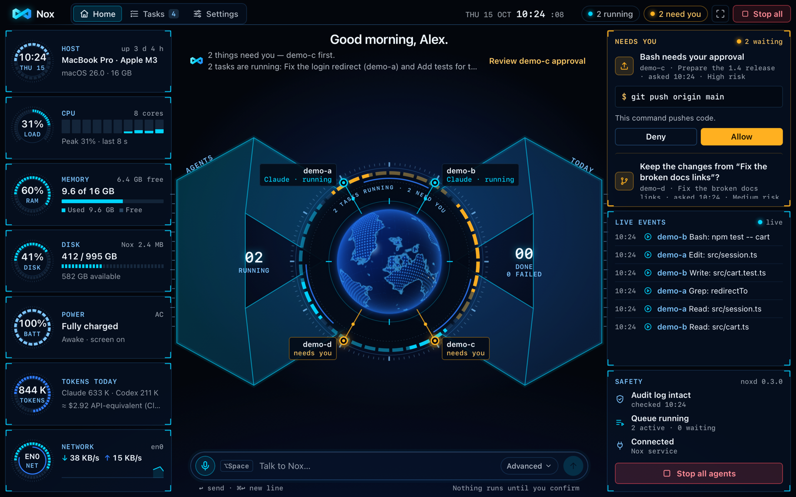
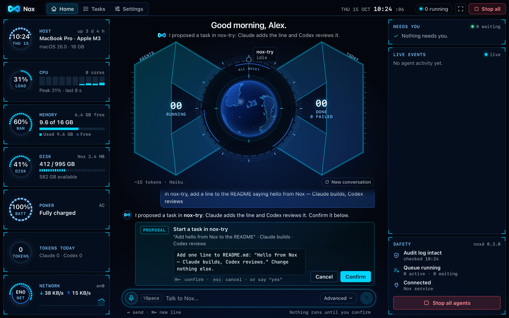
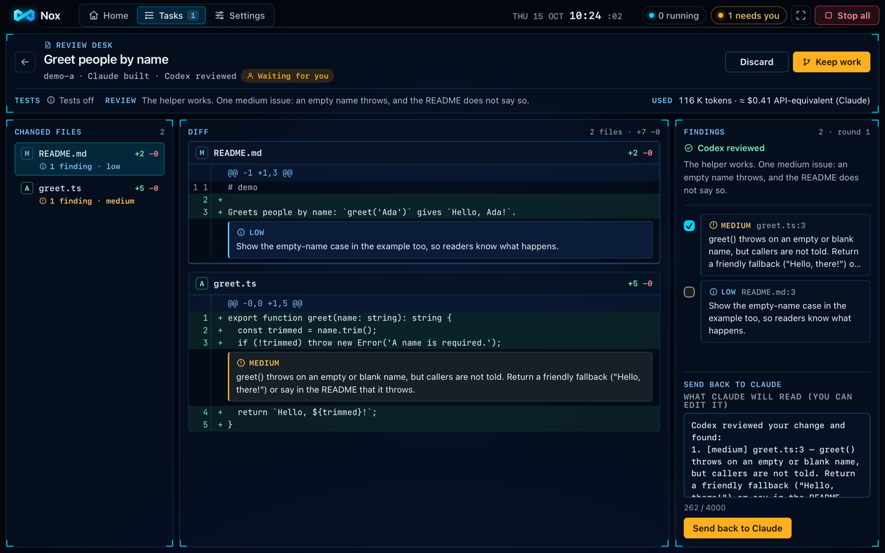
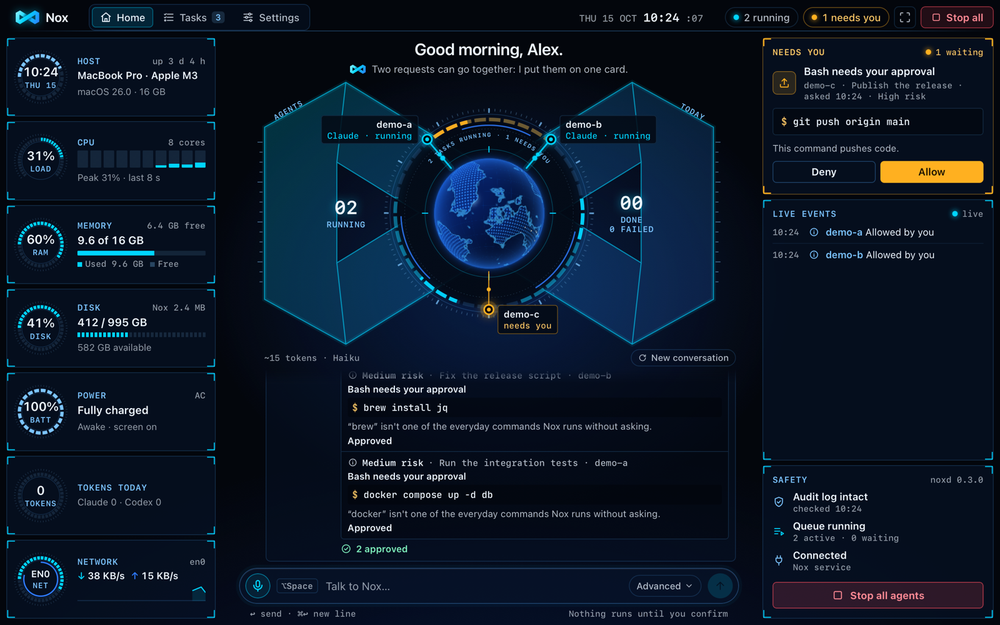
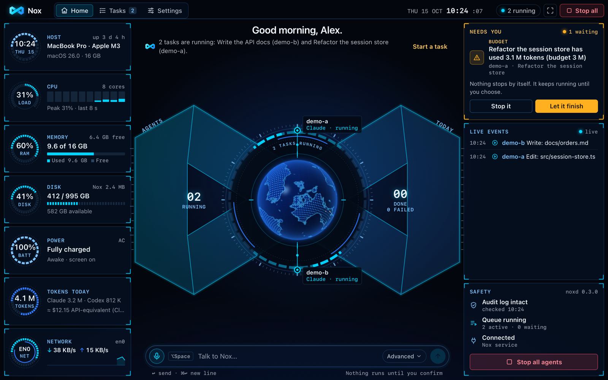
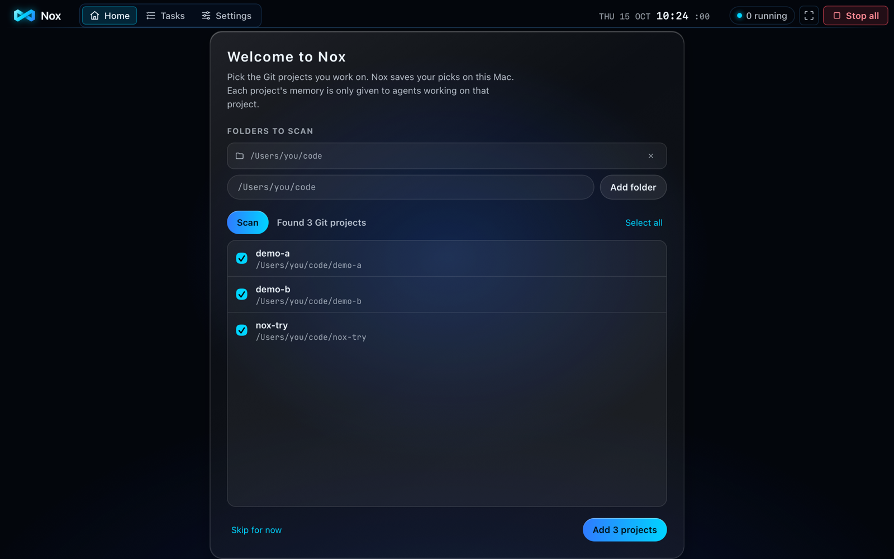
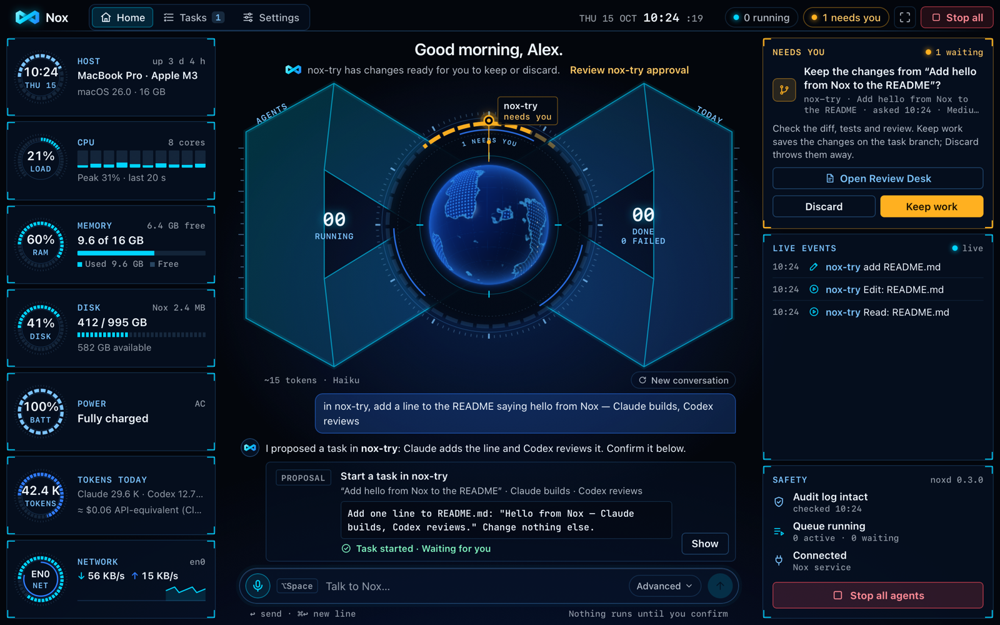

# Nox

**A command centre for your AI coding agents, on your Mac.** Nox runs Claude Code and Codex on your git projects: you
say what you want, one agent builds, the other reviews, and you decide what to keep.

- **Talk, then confirm.** Type or say "in shop, fix the failing date test". Nox shows exactly what will run on a card; nothing starts until you press **Confirm**.
- **Two agents, one team.** One builds, the other reviews, each task in its own copy of your repo. Your files and branch are never touched.
- **A Review Desk.** The diff with every review finding pinned under its line: **Keep work** (saved on a `nox/…` branch), **Send back** or **Discard**.
- **Talk to the fleet.** "Approve the low-risk ones" puts several waiting low- or medium-risk agent requests on one card; high-risk requests are decided one at a time, and **Keep work** / **Discard** is always decided on its own card.
- **Safe by default.** Agents are sandboxed, risky commands wait for **Allow**, `⌥⌘.` stops everything, and every task's tokens are counted against a budget.



<sub>All screenshots are Nox's real window, taken by an automated test with demo projects, simulated agents shown as
Claude and Codex, and a fixed clock. No real work, person or Mac is shown.</sub>

## Screenshots

| | |
|---|---|
|  |  |
| **Talk, then confirm.** The card shows the agent's whole instructions before anything runs. | **Review Desk.** Changed files, the diff, every finding under its line, and Send back. |
|  |  |
| **Several decisions, one card.** Each result shown; the high-risk push still waits for you. | **Tokens and budget.** Tokens today, and a card when a task passes its budget while its agent works. Nothing stops by itself. |
|  |  |
| **First run.** Scan your folders and pick your Git projects. | **Keep work.** Open the Review Desk, then keep the work on its own branch. |

## Install

**You need:** a Mac with Apple Silicon (M1 or newer) on macOS 13 or newer; Claude Code and/or Codex CLI, installed and
logged in with your own account (talking to Nox uses Claude Code); git 2.40 or newer at `/usr/bin/git` (Xcode Command
Line Tools).

1. Download `Nox_<version>_aarch64.dmg` from [Releases](https://github.com/jimmy-nvx/nox-releases/releases/latest).
2. Open the DMG and drag **Nox** into **Applications**.
3. Open Nox the first time. It is not notarized by Apple yet, so macOS blocks a plain double-click once:
   - **macOS 15 and newer:** double-click **Nox** and click **Done**. Open **System Settings → Privacy & Security**,
     scroll to **Security**, click **Open Anyway** next to the message about Nox, and confirm with your password or
     Touch ID.
   - **macOS 13 and 14:** right-click **Nox** in Applications, choose **Open**, then click **Open**.
   - If macOS says Nox is "damaged": run `xattr -dr com.apple.quarantine /Applications/Nox.app` once and try again.

On first launch Nox starts its background service, adds two items to your login Keychain (`pro.nvx.nox.api`,
`pro.nvx.nox.audit`) and shows **Welcome to Nox**, where you pick your projects. Later versions install from inside Nox
(**Update available → Update**).

## How to use it

1. **Pick projects** on the Welcome screen (more later: **Tasks → Add projects**).
2. **Ask** in the bar at the bottom, for example `in nox-try, add a line to the README saying hello from Nox — Claude
   builds, Codex reviews`, and press **Enter**. Or press `⌥Space` and speak.
3. **Confirm** the proposal card. Watch the task on the ring and in **Live events**.
4. **Answer** what waits under **Needs you**: **Allow** or **Deny** a risky command; for finished work, **Open Review
   Desk**, then **Keep work**, **Send back** or **Discard**.
5. **Merge** the `nox/…` branch yourself when you want it. Nox never merges and never pushes.

`⌥⌘.` stops every agent at once. `⌘1` Home · `⌘2` Tasks · `⌘,` Settings. The full illustrated guide is
[Nox User Guide (PDF)](Nox-User-Guide.pdf).

## Evidence

Every number below comes from a recorded run, with its date. Nothing is estimated unless it says so.

### Tests — 2026-10-15, v0.3 before the 0.3.0 release

| Suite | Result |
|---|---|
| Service, scripts and voice-helper tests | 1,288 pass, 0 fail |
| UI unit and component tests | 1,101 pass |
| Rust shell tests | 98 pass |
| End-to-end (Playwright on WebKit, the engine inside the app, against a real Nox service per test) | 44 / 44 pass (plus 6 opt-in screenshot tests, skipped); 88 measured numbers, all within budget |
| Accessibility (axe, WCAG 2 A + AA) | 0 serious or critical issues on every new screen, in default, high-contrast and reduced-motion modes |
| Soak (10 minutes of agents, a service restart and conversation) | passed: 0 errors; page elements not tied to state −0.27 % from minute 2 to 10 (no leak) |

In the end-to-end runs only a simulated agent and a mock assistant run, and every limit is an assertion: a number over
budget fails the run. The accessibility checks and the soak are from an earlier run the same day.

### Performance — 2026-10-15

Measured on 2026-10-15 on an Apple M4 Mac (16 GB); the latest test run kept all 88 measured numbers within budget.

| What | Measured | Budget |
|---|---|---|
| Review Desk: open a 5,000-line diff | 183 ms | ≤ 400 ms |
| Review Desk: scroll it, work per frame (p95) | 5 ms | ≤ 20 ms |
| Built app: cold start, window shown (median of 3) | 289 ms | ≤ 2,000 ms |
| Built app: idle CPU, window visible / hidden | 2.68 % / 0.29 % | ≤ 3 % / ≤ 0.5 % |
| Built app: memory (app + web view) | 170 MB | ≤ 250 MB |
| Background service: idle CPU / memory | 0.51 % / 61 MB | ≤ 1 % / ≤ 150 MB |
| Service killed (`kill -9`) → window reconnected | 927 ms | ≤ 15 s |
| Agent event → on screen (p95) | 2 ms | ≤ 300 ms |
| UI JavaScript, gzipped | 110 KB | ≤ 250 KB |
| DMG size (estimate: the app in the same compressed disk-image format) | 28.5 MB | ≤ 40 MB |

### A real run with real agents — 2026-10-14, Nox 0.2.0 installed from the DMG

**13 / 13 checks passed** on a freshly installed Nox with the real Claude assistant (Haiku), a real Claude build and a
real Codex review, on a throwaway repo: nothing ran before **Confirm**, the Mac was kept awake with the screen on,
**Keep work** saved the change on its own `nox/…` branch, the assistant summed up Codex's review, and the kill switch
stopped everything.

For 0.3.0, the new real-agent checks (approving several requests with the real assistant, Claude running its commands
in bash) are written and run at the release step: they have not been run yet. The 0.3.0 numbers above come from the
automated suite.

### The safety model

- **Sandboxed agents.** Each task runs in its own copy of your repo. Agents can write only inside their task folder,
  cannot read secret files, and get only their own login: other credentials (`GITHUB_TOKEN`, `AWS_*`, your SSH agent)
  are removed, so an agent cannot push or deploy on its own.
- **Approvals.** Risky actions — a push, anything outside the task folder, anything touching secrets, tools Nox does not
  run on its own — wait under **Needs you** with the full command and the reason. A high-risk request is never approved
  in a batch, and keeping or discarding a task's work is always its own decision.
- **Allow-list.** In the default mode agents run only everyday development tools on their own (tests, builds, linters,
  git, file tools). `docker`, `brew`, `curl` and everything else ask first.
- **Plain commands only.** A command runs on its own only when it is plain: words, quotes, pipes, `&&`, `||` or `;`.
  Anything that uses more of the shell (`$( )`, `$VAR`, backticks, `if`/`for` blocks, `&`) waits for you, so the shell
  can never read a command differently from Nox.
- **The assistant only proposes.** It has no tools that change anything. Every action is a card you confirm, and text
  from repos and agents reaches it only as data.
- **Signed updates.** An update installs only if it is signed with Nox's own key; Nox never installs an older or the same
  version, and a failed update leaves Nox unchanged.
- **No personal data in builds.** The app is built so it contains no file paths from the builder's Mac, and the build
  stops if one slips in.
- **Local only.** The service listens on 127.0.0.1. Voice is recognised on the Mac. What leaves your Mac: the agents'
  own calls to their models and the assistant's calls to Claude through your own login.
- **A kill switch and a sealed audit log.** `⌥⌘.` stops every agent; the audit log shows if anyone changed it.

## Uninstall

Quit Nox (menu-bar icon → **Quit Nox**), run `pkill -x noxd`, and delete `/Applications/Nox.app`. Optional: delete
`~/Library/Application Support/Nox` and the two Keychain items:

```sh
security delete-generic-password -s pro.nvx.nox.api -a noxd
security delete-generic-password -s pro.nvx.nox.audit -a noxd
```

Branches Nox saved in your repos (`nox/…`) are yours; Nox never deletes them.
